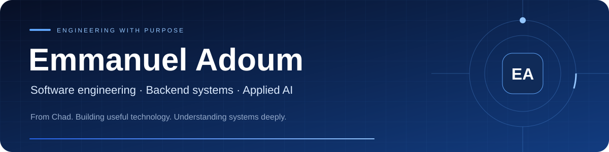
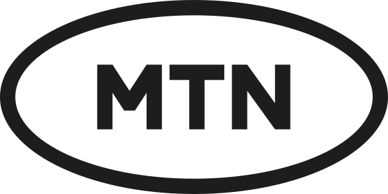
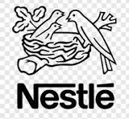
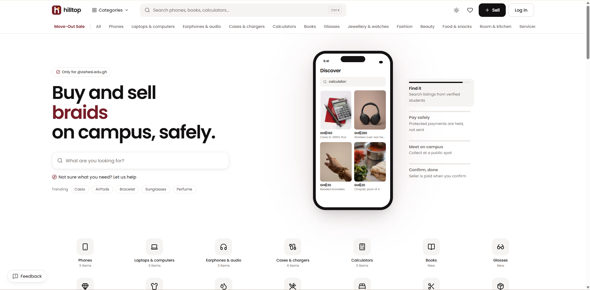
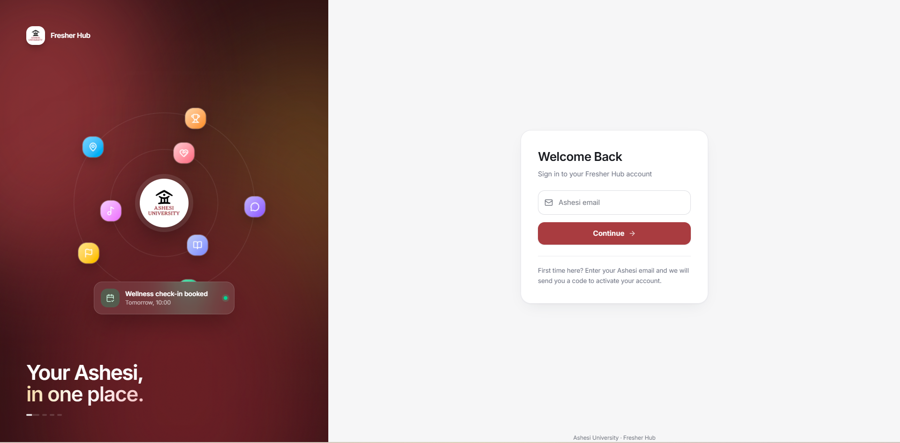
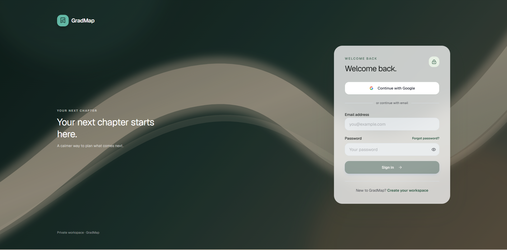
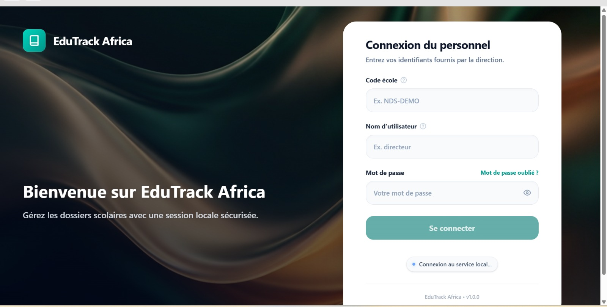
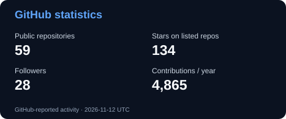

**Computer Engineering at Ashesi University · Mastercard Foundation Scholar**

**President, Mastercard Foundation Scholars Community at Ashesi · Claude Campus Ambassador**

**Meilleur Bachelier du Tchad 2022 · Ranked first nationally**

[Experience](#engineering-experience) · [Products](#selected-products) · [Leadership](#leadership--distinction) · [Join CBC Ashesi](#build-with-us-at-cbc-ashesi)

## About me

I’m **Emmanuel Adoum**, a Chadian Computer Engineering student at Ashesi University in Ghana, graduating in **May 2027**. My interests sit where software, data, and intelligent systems meet.

I’ve worked on lending workflows, risk intelligence, laboratory onboarding, and finance automation. In my own projects, I build tools for campus life, education, and the practical work of staying organized.

I care about understanding a system beneath its interface: how its data is modeled, how access is enforced, what happens when requests fail, and how someone else can maintain it. My goal is to build reliable, useful technology and contribute to Africa’s technological development.

## Engineering experience

<table>
<tr>
<td align="center" width="170"> <strong>Revna Biosciences</strong></td>
<td align="center" width="170"> <strong>Affinity Africa</strong></td>
<td align="center" width="170"> <strong>MTN Ghana</strong></td>
<td align="center" width="170"> <strong>Nestlé NBS</strong></td>
</tr>
</table>

| Organization & role | Selected contribution |
| :--- | :--- |
| **Ashesi Innovation Lab × Revna Biosciences** Project Manager & Backend Engineer Aug - Sep 2026 | Led cross-functional delivery of **ROBIN**, a role-aware onboarding platform for a laboratory, research, and biobank ecosystem. Designed backend services with **FastAPI and PostgreSQL**, covering approvals, documents, permissions, and auditability. |
| **Affinity Africa** Backend Engineering Intern Jul - Aug 2026 | Co-developed a loan automation backend with **FastAPI and MongoDB**. Designed APIs and data models for lending stages, assessments, documents, decisions, SLAs, and audit history; collaborated on API contracts and handover. |
| **MTN Ghana** Quantitative & Predictive Risk Modelling Intern Technical Lead & System Architect May - Jul 2026 | Led technical delivery in a four-person team building a risk intelligence platform. Designed ingestion across **18+ news feeds** and worked on NLP risk signals, forecasting, stress testing, and Monte Carlo simulation. |
| **Nestlé Business Services Accra** Record-to-Report & Automation Intern Jun - Aug 2025 | Automated KRI and OLI reporting with **Power BI, Excel, Power Automate, and Python**. Built reusable ETL scripts and templates, documented workflows, and trained colleagues for handover. |

## Selected products

Real interfaces, practical problems, and the engineering behind them. Screenshots show the supplied interface previews; they do not imply that every planned feature is complete.

<table>
<tr>
<td width="50%" valign="top">

### Hilltop
**Campus commerce with trust in the workflow**

A marketplace for Ashesi students to discover listings, contact sellers, and reserve items for pickup.

**Engineering:** marketplace and admin applications, shared packages, configurable platform rules, school-email verification, and database permissions.

**Stack:** Next.js · TypeScript · Supabase · Cloudflare

[Visit Hilltop ↗](https://hilltop.lumavok.com) · [Source](https://github.com/adoumouangnamouemmanuel/hilltop) · [Reliability notes](https://github.com/adoumouangnamouemmanuel/hilltop/blob/main/docs/RELIABILITY-REMEDIATION.md)

</td>
<td width="50%" valign="top">

### Freshers Hub
**Campus information and support in one place**

A platform I **co-founded and lead development on**, connecting students with campus offices, appointments, support services, and community resources.

**Engineering:** React Native and web clients, Node.js APIs, PostgreSQL workflows, OTP authentication, staff workspaces, and access controls.

**Stack:** TypeScript · React Native/Expo · Node.js · PostgreSQL

**Role:** Co-founder & Development Lead 
**Source:** Private · Pilot acceptance and deployment work remain in progress.

</td>
</tr>
<tr>
<td width="50%" valign="top">

### GradMap
**A clearer view of the next chapter**

A workspace for organizing graduate-school and scholarship applications, programs, deadlines, tasks, and document versions.

**Engineering:** private file access, multi-factor authentication boundaries, ownership policies, document workflows, and reminder scheduling.

**Stack:** Next.js · TypeScript · Supabase · PWA

[Visit GradMap ↗](https://gradmap.emmanueladoum.com) · [Source](https://github.com/adoumouangnamouemmanuel/gradmap) · [Architecture](https://github.com/adoumouangnamouemmanuel/gradmap/blob/master/docs/ARCHITECTURE.md) · [Tests](https://github.com/adoumouangnamouemmanuel/gradmap/tree/master/supabase/tests)

</td>
<td width="50%" valign="top">

### EduTrack Africa
**School administration for local realities**

A French-first, offline-first Windows product for schools in Chad, focused on academic records, term results, and printable bulletins.

**Engineering:** a local API, separate domain calculations, SQLite persistence, and a desktop shell. **Currently in foundation development.**

**Stack:** React · Tauri · Fastify · SQLite

[Explore the build](https://github.com/adoumouangnamouemmanuel/sms) · [Architecture decisions](https://github.com/adoumouangnamouemmanuel/sms/tree/main/docs/decisions) · [Tests](https://github.com/adoumouangnamouemmanuel/sms/tree/main/tests)

</td>
</tr>
</table>

## Leadership & distinction

| Role or distinction | Context |
| :--- | :--- |
| **President, Mastercard Foundation Scholars Community at Ashesi** | Current president, representing scholars and supporting welfare, academic support, and council initiatives. |
| **Claude Campus Ambassador at Ashesi** | Current ambassador, growing a community of students learning and building through CBC Ashesi. |
| **Former President, International Students Association** | Jan 2025 - Jan 2026. Represented 400+ international students at Ashesi. |
| **Former Lead, Ashesi AI Club** | Jan 2025 - Sep 2026. Led AI community initiatives and supported student learning. |
| **Mathematics & programming tutor** | Supporting students in calculus, programming, object-oriented design, and algorithms. |

**Selected distinctions:** National Best Baccalaureate Student, Chad (2022) · 1st place, Ashesi Career Fair Programming Competition (2026) · Winning team, Nestlé Ghana Sentiment Analysis Competition (2024) · 1st place, programming competition in Niamey, Niger (2023).

### Build with us at CBC Ashesi

**New to AI or already building? You are welcome here.**

Join the **Claude Builder Club at Ashesi University** to learn, exchange ideas, meet other builders, and develop practical projects together.

[Register for CBC Ashesi →](https://www.jotform.com/253555944387168)

## Technical toolkit

| Area | Technologies used across work, projects, and learning |
| :--- | :--- |
| **Backend & data** | Python, FastAPI, Java, Spring Boot, Node.js, SQL, PostgreSQL, MongoDB |
| **Web & mobile** | TypeScript, React, Next.js, React Native/Expo |
| **AI & analytics** | NLP, PyTorch, scikit-learn, pandas, NumPy, forecasting, Monte Carlo simulation |
| **Systems & automation** | C, STM32, ESP32, Docker, Linux, Power BI, Power Automate |

## Learning & exploration

**Currently deepening:** backend architecture and security, data structures and algorithms, operating systems, networking, and embedded systems.

- **[Computer from Scratch](https://github.com/adoumouangnamouemmanuel/computer-from-scratch):** building understanding from digital logic toward computer architecture.
- **[Moussey-French language technology](https://github.com/adoumouangnamouemmanuel/moussey-french-translator):** corpus work, a digital dictionary, and prototype translation workflows for a low-resource African language.
- **[Ghana Road Transport Network](https://github.com/adoumouangnamouemmanuel/ghana-transport-network-2026):** a collaborative graph-algorithm project with Java, Spring Boot, and an interactive interface.

## Activity & consistency

[View my contribution calendar on GitHub](https://github.com/adoumouangnamouemmanuel#year-list-container)

<picture>
<source media="(prefers-color-scheme: dark)" srcset="https://raw.githubusercontent.com/adoumouangnamouemmanuel/adoumouangnamouemmanuel/output/github-contribution-grid-snake-dark.svg" />

</picture>

**Understand deeply. Build thoughtfully. Keep improving.**

[Explore my work](https://emmanueladoum.com) · [Connect on LinkedIn](https://www.linkedin.com/in/emmanueladoum) · [Get in touch](mailto:emmanuel.ouangnamou@gmail.com)

